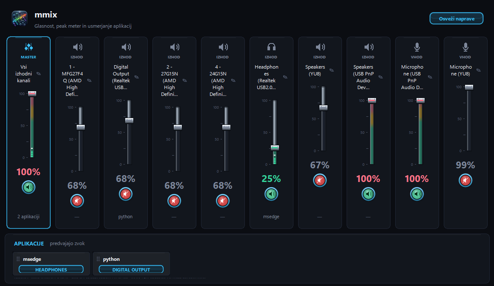

# mmix

Sodoben temen mešalnik glasnosti za **vse zvočne naprave v Windows** – z master
kanalom, LED peak meterjem, preimenovanjem kanalov, kovinskimi drsniki,
**usmerjanjem posameznih aplikacij na izbrano izhodno napravo** in pregledom,
kaj predvaja na vsaki napravi.



> Windows 10/11 (x64) · brez nameščenega Pythona · slovenski vmesnik

---

## Namestitev

1. Prenesi **`mmix_setup.exe`** iz zavihka [**Releases**](../../releases/latest).
2. Zaženi namestitveni program – namesti se za trenutnega uporabnika, **brez
   skrbniških pravic**.
3. `mmix` se pojavi v Start meniju; bližnjico na namizju lahko dodaš s kljukico
   med namestitvijo.

Namestitev vključuje tudi odprtje v *Nastavitve → Aplikacije*, kjer ga lahko
kadarkoli odstraniš.

### Prenosna različica

Za prenosno uporabo zadostuje `mmix.exe` iz izdaje – datoteke ne piše v mapo
programa, le imena kanalov shranjuje v
`%APPDATA%\VolumeMixer\names.json` (isto mesto kot izvirnik, zato se imena
ohranijo).

---

## Funkcije

| | |
|---|---|
| 🎚️ **Vse naprave hkrati** | Kartica za vsako aktivno izhodno in vhodno napravo, razvrščena po imenu. |
| 🎛️ **Master kanal** | »Vsi izhodni kanali« – premik ali utišanje masterja vpliva na vse izhode. |
| 📊 **LED peak meter** | 30-segmentni merilnik ravni z barvnimi conami (zelena → rumena → rdeča) in kratkim zadržanjem vrha. |
| 🔇 **Okrogli gumbi za utišanje** | Zeleno jedro = zvok aktiven, rdeče = utišano; moder obroč v barvi `MASTER`. |
| ✏️ **Preimenovanje** | Dvojni klik na ime (ali svinčnik) odpre vnos; ime se shrani trajno. |
| 🎧 **Aplikacije** | Spodnja plošča sproti prikazuje programe, ki trenutno predvajajo zvok; aplikacijo preprosto povlečeš na želen kanal. |
| 🏷️ **Kaj predvaja** | Pod vsakim izhodnim drsnikom so imena aplikacij, ki na tej napravi dejansko predvajajo zvok; MASTER prikaže skupno število. |
| 🔄 **Osveži naprave** | Znova prebere seznam naprav (npr. po priklopu USB slušalk) – brez podvajanja kartic. |
| 🎨 **Temna tema** | Lasten videz: zaobljene kartice, kovinski pravokotni drsniki, mehki prelivi, anti-aliasing prek Pillow. |
| ⌨️ **Globalne bližnjice** | Glasneje, tišje, utišaj, prikaži mmix in osveži naprave delujejo tudi, ko je mmix v ozadju; kombinacije se urejajo v oknu **Bližnjice**. |
| 🪟 **Adaptivno okno** | Okno je široko in visoko in se lahko raztega; kartice z drsniki se prerazporedijo v več vrstic glede na širino okna. |

### Prilagoditev velikosti okna

Okno je odprto in široko, zato se pri odprti **prilagoditev na podlagi velikosti okna** izvede tako:

- **Širina okna:** koliko kartic z drsniki se vnaša v eno vrstico, odloča
  širina okna – ob ~450 px širine okna drsniki prevladajo v več vrstic, ob
  širšem se vrneta v eno vrstico. Vse kartice se izpustijo iz zbirke in vsebina
  se shranja na posamezne naprave.
- **Višina okna:** drsnik (sled + knob) se **prilagaja velikosti okna**. Prosto
  višino okna porazdeli med vrstice, kartice pa se raztegnejo ali skrčijo skupaj
  z oknom. Pri ozkem oknu drsnik zatreja do minimalne višine, pri večjem pa
  raste (razpon 80–440 px).

### Upravljanje

- **Drsnik** – povleci z miško ali zavrti kolešček nad njim.
- **Odstotek** – klik na vrednost nastavi 100 %.
- **Utišaj** – klik na okrogli gumb.
- **Ime** – dvojni klik za preimenovanje, `Enter` potrdi, `Esc` prekliče.
- **Aplikacija** – povleci jo s plošče na kanal (glej spodaj); klik na gumb
  odpre seznam naprav.
- **Imena pod drsniki** – sproti kažejo, katere aplikacije predvajajo na
  posamezni napravi.
- **Bližnjice** – gumb v glavi odpre urejanje globalnih kombinacij.

### Globalne bližnjice

| Dejanje | Privzeto |
|---|---|
| Glasneje | `Ctrl+Alt+Shift+Up` |
| Tišje | `Ctrl+Alt+Shift+Down` |
| Utišaj / vklopi zvok | `Ctrl+Alt+Shift+M` |
| Prikaži mmix | `Ctrl+Alt+Shift+O` |
| Osveži naprave | `Ctrl+Alt+Shift+R` |

Bližnjice delujejo **globalno**, tudi ko je mmix minimiziran ali pokrit z
drugim oknom. Glasnost spreminjata po 5 % na pritisk in delujeta na **MASTER**
(vse izhodne naprave hkrati). Ob spremembi se prikaže majhen OSD s trenutno
glasnostjo.

Kombinacije spremeniš z gumbom **Bližnjice** v glavi okna: klikni trenutno
kombinacijo in pritisni novo. Shranjene so v
`%APPDATA%\VolumeMixer\hotkeys.json`, zato ostanejo tudi po ponovnem zagonu.
Če kombinacijo že uporablja druga aplikacija, mmix ob zagonu pokaže opozorilo;
izberi drugo.

Za **Stream Controller (SOOMFON)** je pripravljen vtičnik **mmix**: v zavihku
*Keys* se prikaže kot svoja kategorija z 14 dejanji (glasneje / tišje / utišaj
za MASTER, ZVOČNIKI, SLUŠALKE in ZASLON ter *Prikaži mmix* in *Osveži naprave*).
Vsako dejanje ima svojo ikono, zato jih samo povlečeš na tipke. Vtičnik se z
mmixom pogovarja po lokalnem mostu `127.0.0.1:28197`, zato mora mmix teči (lahko
minimiziran).

Za **Stream Deck** uporabi akcijo *Hotkey* in pritisni isto kombinacijo. Ikone
so pripravljene v mapi [`streamdeck/`](streamdeck/README.md): mapa
`streamdock/mmix.sdIconPack` je paket za Stream Controller,
`mmix.streamDeckIconPack` pa za Elgato Stream Deck.

### Usmerjanje aplikacij

Spodnja plošča **APLIKACIJE · predvajajo zvok** prikaže vsak program, ki ima
trenutno odprt zvočni tok (brskalnik, predvajalnik, igra …). Plošča se osvežuje
sama in se ne podvaja.

1. Zaženi predvajanje v aplikaciji, ki jo želiš premakniti.
2. Primi vrstico aplikacije (pika za prijem na levi ali ime) in jo **povleci
   na kanal**, kjer naj se predvaja.
3. Med vlečenjem se vsi izhodni kanali obarvajo, ciljni pa je poudarjen; ob
   kazalcu se izpiše trenutna tarča (`→ DIGITAL OUTPUT`).
4. Spusti – statusna vrstica potrdi premik (`msedge → DIGITAL OUTPUT`), gumb v
   vrstici pa pokaže izbrano napravo.

Namesto vlečenja lahko **klikneš gumb z imenom naprave** v vrstici aplikacije
(privzeto `SISTEMSKO`) in izbereš izhod s seznama – `Sistemsko privzeto` ali
katero od aktivnih izhodnih naprav. To je priročno, kadar želiš natančno izbrati
napravo z dolgim imenom.

Spust na **MASTER** (»Vsi izhodni kanali«) pomeni **sistemsko privzeto** – isto
kot izbira `Sistemsko privzeto` na seznamu. Izbira se shrani v Windows in velja
tudi po ponovnem zagonu aplikacije.

Pod vsakim izhodnim drsnikom so izpisana imena aplikacij, ki na tej napravi
**dejansko** predvajajo zvok (največ dve imeni, preostala so prikazana kot
`+N`). Seznam se osvežuje samodejno; MASTER prikaže skupno število aplikacij.
Če se gumb v vrstici aplikacije in napis pod drsnikom razlikujeta, aplikacija
še vedno predvaja na stari napravi – premik bo veljal ob naslednjem zvočnem
toku.

> **Namig:** Windows izbiro uporabi, ko aplikacija odpre **nov zvočni tok**.
> V praksi to pomeni, da je treba predvajanje pogosto ustaviti in znova zagnati
> (nov zavihek, naslednja pesem, ponovni zagon aplikacije); nekatere starejše
> aplikacije (`winmm`, PortAudio) izbire ne upoštevajo. Enako se obnaša tudi
> sistemski mešalnik v *Nastavitvah → Zvok*.

---

## Izvor projekta

`mmix` je **neodvisna rekonstrukcija** uporabniškega vmesnika in delovanja
starejše slovenske aplikacije *VolumeMixer*, izdelana iz analize izvršljive
datoteke (bytecode) za osebno rabo. To **ni izvirna izvorna koda** in ni
povezano z izvirnim avtorjem.

Videz in ime sta spremenjena (`mmix`, lastna ikona, preoblikovani gumbi in
drsniki), slovenski napisi in osnovna logika (master kanal, merilniki,
shranjevanje imen) pa so ostali enaki, da je aplikacija domača uporabnikom
izvirnika.

---

## Razvoj

### Zahteve

- Python 3.11+ (razvijano na 3.15)
- Windows 10/11

```powershell
pip install -r requirements.txt
```

### Zagon iz izvorne kode

```powershell
python mmix.py
```

### Gradnja samostojnega `.exe`

```powershell
python -m PyInstaller --noconfirm --clean --onefile --windowed `
    --name mmix --icon "$PWD\mmicon.ico" `
    --add-data "$PWD\mmicon.ico;." --add-data "$PWD\mmicon_header.png;." `
    --exclude-module numpy --exclude-module sounddevice `
    --exclude-module scipy --exclude-module matplotlib --exclude-module pandas `
    --distpath . --workpath "$env:TEMP\mmix_build\work" `
    --specpath "$env:TEMP\mmix_build" mmix.py
```

> Poti pri `--add-data` in `--icon` so namerno absolutne (`$PWD`), ker
> PyInstaller relativne poti računa glede na `--specpath` (tu je v `%TEMP%`).

> PyInstaller v `.exe` vključi vse potrebno (Python, Tk, pycaw, Pillow), zato
> na ciljnem računalniku ni treba ničesar nameščati. `--onefile` pomeni nekoliko
> počasnejši zagon (razširjanje v začasno mapo).

### Gradnja namestitvenega programa

Potrebuješ [Inno Setup 6](https://jrsoftware.org/isinfo.php):

```powershell
& "$env:LOCALAPPDATA\Programs\Inno Setup 6\ISCC.exe" mmix_setup.iss
```

Rezultat je `mmix_setup.exe` – namestitev za enega uporabnika v
`%LOCALAPPDATA%\Programs\mmix`, z bližnjicama v Start meniju in (izbirno) na
namizju ter vpisom v *Nastavitve → Aplikacije*. Isti `AppId` omogoča nadgradnjo
brez podvojenih vnosov.

### Struktura

```
mmix.py                  # celotna aplikacija (UI + pycaw + bližnjice + usmerjanje)
mmix_setup.iss           # skripta za Inno Setup
make_streamdeck_icons.py # generator ikon za Stream Deck / Stream Dock
fix_mm_plugin.py         # zgradi vtičnik mmix za Stream Controller (manifest + stran)
make_mmix_plugin_keys.py # ikone dejanj vtičnika (144 × 144 PNG)
mmicon.ico               # ikona aplikacije in namestitvenega programa
mmicon_header.png        # logotip v glavi okna
requirements.txt         # Python odvisnosti
streamdeck/              # ikone za Stream Deck + Stream Dock in navodila
docs/                    # posnetki za README
```

---

## Znane omejitve

- Usmerjanje uporablja isti (nedokumentirani) sistemski mehanizem kot
  *Nastavitve → Sistem → Zvok → Glasnost mešalnika*. Nekatere aplikacije
  premik upoštevajo šele ob **naslednjem predvajanju**, redke starejše
  (`winmm`, PortAudio) pa ostanejo na sistemski napravi. Imena pod drsniki
  zato kažejo **dejansko** napravo predvajanja, ki se lahko do naslednjega
  toka razlikuje od izbire na gumbu.
- Peak meter je lahko na nekaterih gonilnikih počasnejši ali manj natančen.
- Globalne bližnjice so vezane na eno kombinacijo na dejanje. Če isto
  kombinacijo uporablja druga aplikacija, je mmix ne more registrirati – ob
  zagonu pokaže opozorilo, novo kombinacijo pa izbereš v oknu **Bližnjice**.
- Brez podpisa kode: Windows SmartScreen lahko ob prvem zagonu pokaže
  opozorilo »Unknown publisher«.

## Licenca

Za zdaj **brez licence** – vse pravice pridržane. Če želiš kodo prosto
uporabljati in spreminjati, predlagam dodajanje licence MIT; odpri issue ali
povej, pa jo dodam.
